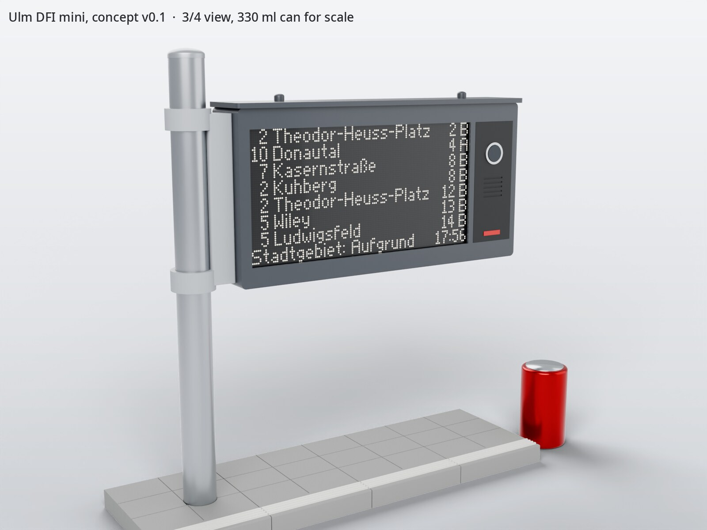
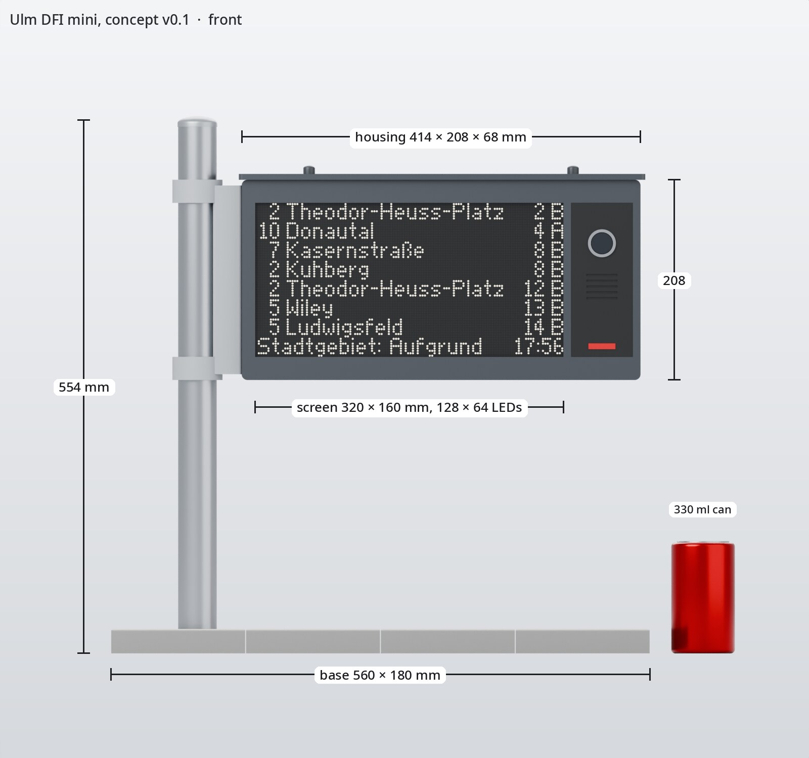
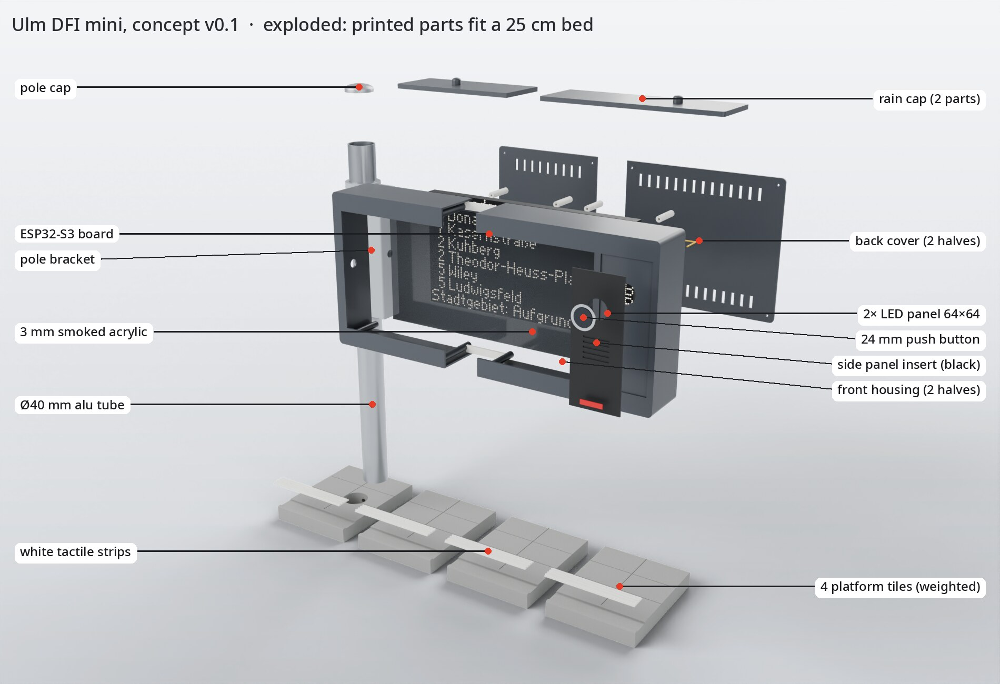
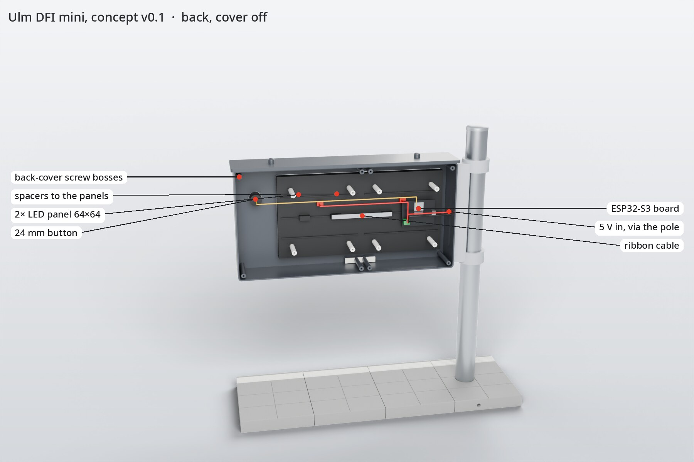
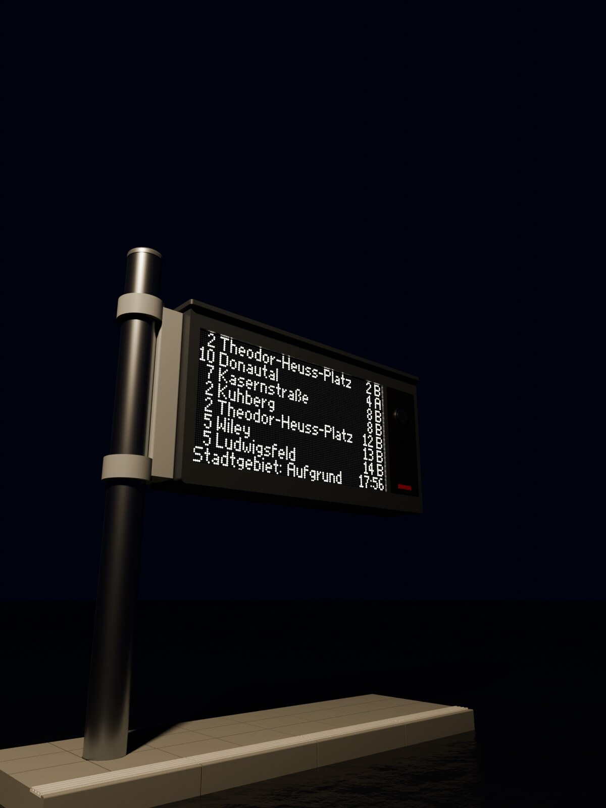

# Ulm DFI mini

A desk-size replica of the electronic departure signs (DFI) at Ulm's tram and bus stops: pole, housing and a real dot-matrix screen driven by an ESP32.

**Status: concept v0.1.** The 3D model is there to judge the look and the proportions. The parts are not print-ready yet (no tolerances or screw details tested).



## Size

| | |
|---|---|
| Screen | 320 × 160 mm, 128 × 64 LEDs |
| Housing | 414 × 208 × 68 mm |
| Total height | 55 cm |
| Base | 560 × 180 mm, a slice of tram platform with the white tactile strip |

All of it is set by the parameters at the top of [`model.py`](model.py). `CLEAR` (free pole under the sign) is the one to change for a shorter version.

## Screen

Two **P2.5 64×64 HUB75 LED panels** (160 × 160 mm each) side by side make the 320 × 160 mm screen with 128 × 64 LEDs. That is 8 rows of text: 7 departures and a footer with the clock, like the real sign. White LEDs behind 3 mm smoked acrylic give the dark-glass, white-dot look.

An **ESP32-S3 HUB75 board** (for example the Adafruit MatrixPortal S3) plugs straight into the first panel and drives both with the `ESP32-HUB75-MatrixPanel-DMA` library.

Other screens that would fit:

- **4× P2.5 64×32** panels in a 2 × 2 grid: same size and resolution, often cheaper.
- **13.3" e-paper**: no glow and slow refresh, but silent and very low power.
- **12.3" bar LCD** (1920 × 720): sharp, but needs HDMI, so a Raspberry Pi instead of an ESP32.

## Parts

Printed parts (all fit a 250 × 210 mm bed):

- Front housing in 2 halves, split at the seam between the two panels, printed face down
- Rain cap in 2 halves
- Back cover in 2 halves, or one piece cut from 3 mm plywood or ABS sheet
- Side panel insert (black) and small label (red)
- Pole bracket, slid down the pole and fixed with grub screws
- Pole cap
- Base: 4 platform tiles plus 4 white tactile strips, filled with sand or steel washers
- Spacers between the panels and the back cover, splice plates for the housing halves

Bought parts:

- 2× P2.5 64×64 HUB75 LED panels (or 4× 64×32)
- ESP32-S3 HUB75 board (Adafruit MatrixPortal S3 or similar)
- 40 mm aluminium tube, 54 cm (or 40 mm PVC pipe, painted)
- 3 mm smoked grey acrylic, 328 × 168 mm
- 24 mm momentary push button (the round button on the side panel)
- 5 V 4 A power supply and a DC jack (in the base; the cable runs up inside the pole)
- M3 screws and heat-set inserts

## Cost

A rough estimate from November 2026, without printing time or electricity:

| | |
|---|---|
| PLA, about 1.6 kg (dark grey 690 g, light grey 850 g, a little white, black and red) | 20–30 € |
| 2× P2.5 64×64 LED panels | 35–70 € |
| ESP32-S3 HUB75 board | 15–25 € |
| 5 V 4 A power supply | 10–15 € |
| Smoked acrylic, 3 mm, cut to 328 × 168 mm | 8–15 € |
| Ø40 mm aluminium tube, 55 cm (a PVC pipe is 3–5 €) | 10–15 € |
| 24 mm button, DC jack, wires | 8–12 € |
| M3 screws and heat-set inserts | 0–12 € |
| **Total** | **about 105–195 €, realistically around 140 €** |

The base tiles are almost half of the plastic (about 750 g). A wooden board instead saves about 10 €. `uv run python filament.py` recalculates the filament after a design change.









## Build the model and the images

Needs [uv](https://docs.astral.sh/uv/). It installs Python 3.11, [build123d](https://github.com/gumyr/build123d) and Blender as a Python module (`bpy`, about 1 GB).

```sh
uv run python model.py     # parts -> out/stl/*.stl and out/parts.json
uv run python render.py    # images -> out/render/*.png
uv run python render.py hero --fast   # one quick, low-quality view
```

Views: `hero`, `front`, `back`, `exploded`, `night`.

## Next steps

1. Pick the screen and order one panel to check its real size and post positions.
2. Make the parts print-ready: tolerances, heat-set inserts, panel mounting, cable path.
3. Firmware: show the live departures of a stop from DING's EFA real-time API.
